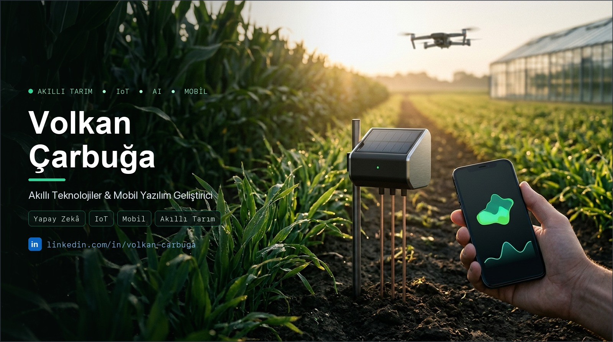

<!-- Akıllı Tarım, IoT, Yapay Zekâ & Mobil Profil Banner -->

  

<!-- Canlı Yazı Animasyonu -->

  

<!-- İletişim & Canlı Profil Rozetleri -->

  
  

---

### 👋 Hakkımda

Merhaba! Ben **Volkan Çarbuğa** — gerçek dünya problemlerini **uçtan uca çalışan, sürdürülebilir ürünlere** dönüştürmeye odaklanan bir **Mobil, Full-Stack ve AI Geliştiricisiyim**.

* 📱 **Mobil Geliştirme:** Flutter & React Native ile uzun soluklu üretim uygulamaları, yönetici panelleri ve mağaza yayınları geliştiriyorum.
* 🌐 **Web & Backend:** React, TypeScript, Node.js ve PHP/MySQL ile e-ticaret, eğitim ve kurumsal yönetim platformları kuruyorum.
* 🤖 **Yapay Zekâ & Sistem Araçları:** Python, NLP, LLM otomasyonları ve düşük seviye macOS (`CoreGraphics`, `ADB`, `WebSocket`) sistem araçları üretiyorum.
* 🛠️ **Güncel Odak:** `Ekran Yansıtıcı` (açık kaynak), `Business Hub`, `Akıllı Çiftçi` ve AI tabanlı otomasyon araçları.

---

### 🚀 Öne Çıkan Açık Kaynak Projelerim

| Proje | Teknoloji | Açıklama |
| :--- | :--- | :--- |
| **[🖥️ Ekran Yansıtıcı](https://github.com/VolkanCARBUGA/ekran-yansitici)** | `Python` `macOS CoreGraphics` `ADB` `WebSocket` `PWA` | Ekranı kırık Mac dizüstünü herhangi bir Android tableti **USB tak-çalıştır veya Wi-Fi** üzerinden 60 FPS, canlı imleçli, dokunmatik ve pinch-zoom destekli ana monitöre dönüştüren sıfır-kurulumlu sistem. |
| **[🧭 Kaşif](https://github.com/VolkanCARBUGA/kasif)** | `JavaScript` `MIT` | Açık kaynak keşif ve web uygulaması projesi (⭐ 3). |
| **[🕌 Ezan Vakti](https://github.com/VolkanCARBUGA/ezan_vakti)** | `Flutter` `Dart` | Modern arayüzlü günlük namaz vakitleri ve takip uygulaması. |
| **[🤖 AI Chat Bot App](https://github.com/VolkanCARBUGA/ai_chat_bot_app)** | `Flutter` `Dart` `AI API` | Yapay zekâ destekli mobil sohbet asistanı uygulaması. |
| **[🛒 Flutter E-Commerce](https://github.com/VolkanCARBUGA/flutter_ecommerce)** | `Flutter` `Dart` | Ürün kataloğu, sepet ve sipariş akışlarını içeren kapsamlı mobil e-ticaret mimarisi. |
| **[🧠 Natural Language Processing](https://github.com/VolkanCARBUGA/natural-language-processing)** | `Python` `NLP` `ML` | Doğal dil işleme modelleri, metin analizi ve veri bilimi çalışmaları. |

---

### 🏭 Üretim & Ticari Ürün Vitrini *(Private Repolar)*

> Müşteri gizliliği veya ticari yayın nedeniyle kaynak kodu özel (`Private`) tutulan, uçtan uca tasarlayıp geliştirdiğim aktif projeler:

| Ürün / Ekosistem | Alan & Rol | Teknoloji Yığını | Süre / Durum |
| :--- | :--- | :--- | :--- |
| **Sorento Mobil** | Uzun soluklu kurumsal mobil uygulama | `Flutter` `Dart` | ~2 Yıl • Üretim |
| **E-Döner & Kaos Admin** | Müşteri sipariş uygulaması + ayrı yönetici paneli | `Flutter` `Dart` | 9+ Ay • Ekosistem |
| **Akıllı / Hesaplı Çiftçi** | Tarım & çiftçi yönetimi mobil uygulaması | `Flutter` `Dart` | Aktif • Store Yayını |
| **Bilgin Platformu** | Çoklu platform ürün ailesi *(Ana Platform + Mobil + Web + Tanıtım)* | `HTML/JS` `Flutter` | 5+ Ay • Aktif |
| **Business Hub** | İşletme & operasyon yönetimi mobil uygulaması | `Flutter` `Dart` | 5+ Ay • Aktif |
| **Ege Fason** | Zeytinyağı & doğal ürün e-ticaret sistemi | `React` `TypeScript` `PHP` `MySQL` | Üretim |
| **Sorumluluk Sınav & Eğitim** | Sınav ve çevrimiçi eğitim yönetim platformları | `TypeScript` `Web` | Aktif |
| **Acil Yardım** | Konum/destek odaklı mobil uygulama | `Flutter` `Dart` | 6 Ay • Geliştirildi |
| **AI Job Search** | Yapay zekâ destekli iş arama ve eşleştirme otomasyonu | `Python` `AI` | Aktif |

---

### 🛠️ Teknoloji Yığınım

  

---

### 📊 Canlı GitHub İstatistiklerim

  
  

  

  

---

<!-- Alt Dalga Footer (Retina PNG) -->

  

